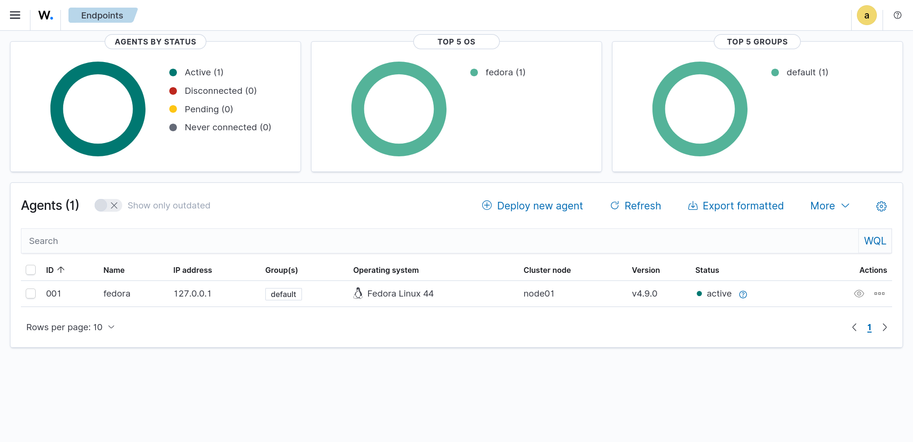
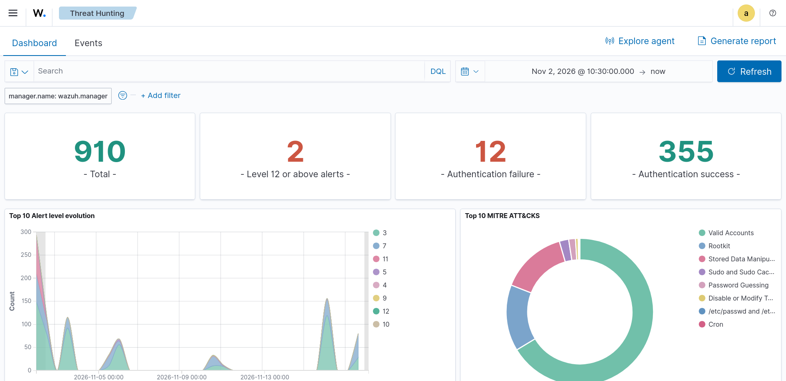
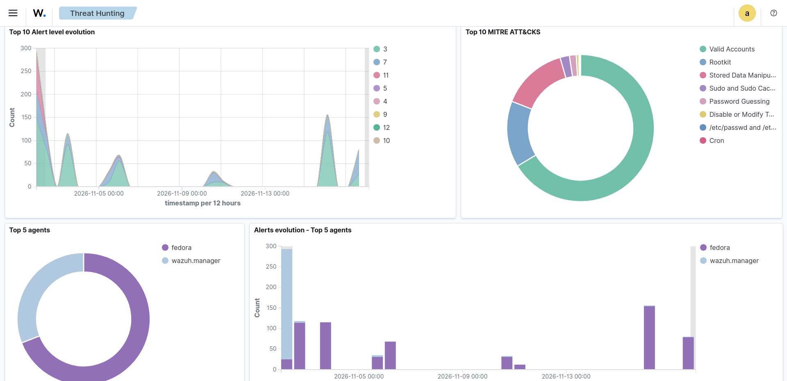
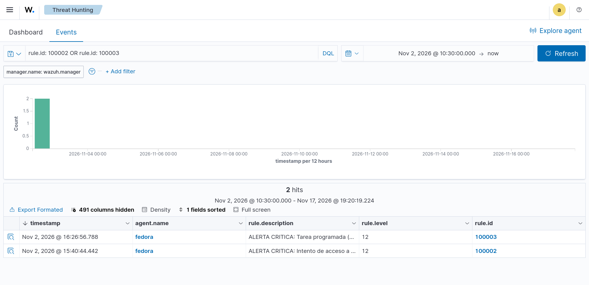
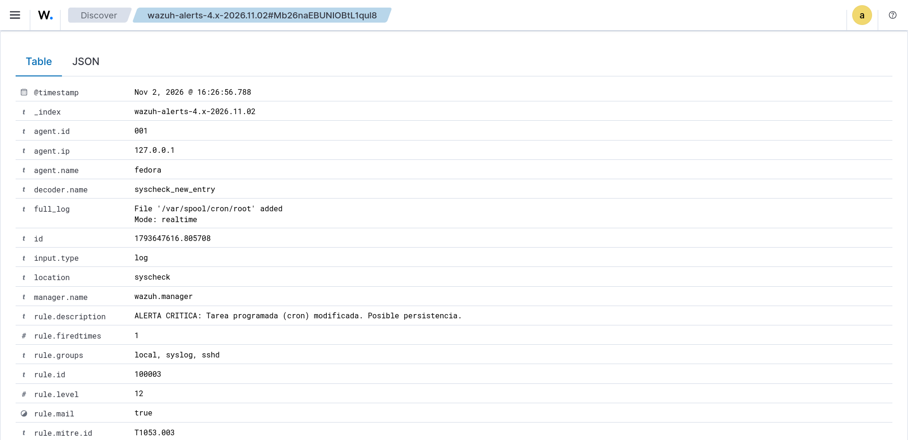
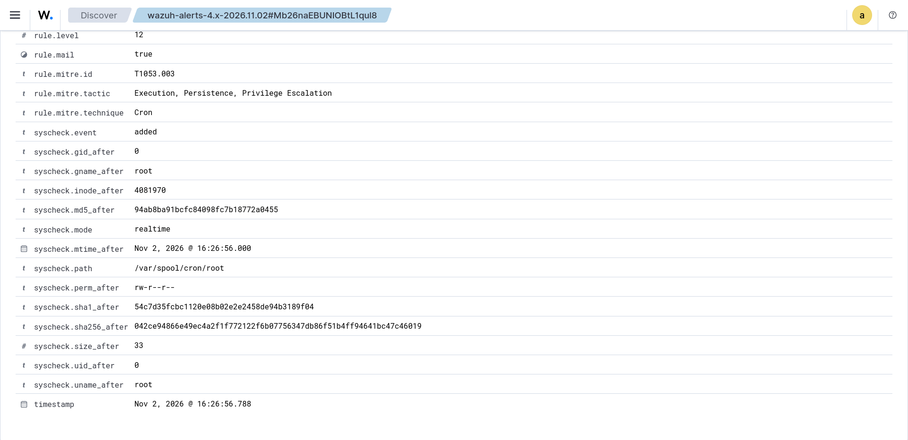
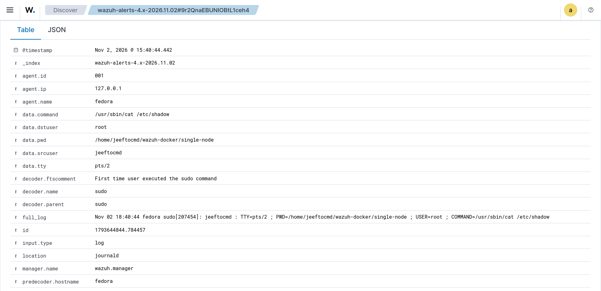
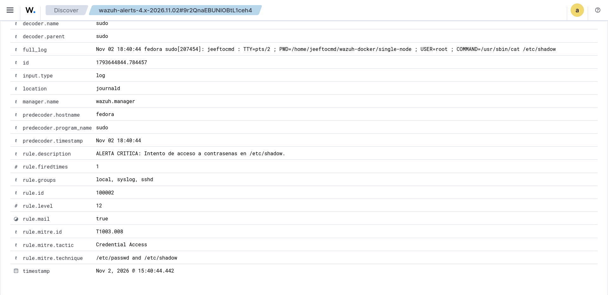

Implementación de SIEM local con Wazuh y Linux (Fedora)

Proyecto de laboratorio SOC (Security Operations Center) enfocado en la arquitectura, ingestión de telemetría, monitoreo de integridad de archivos (FIM) y creación de lógicas de detección personalizadas. El objetivo del laboratorio es simular amenazas reales en un entorno Linux, detectar comportamientos anómalos y realizar Threat Hunting mapeando los incidentes con el framework MITRE ATT&CK.

Arquitectura y Tecnologías
    • SIEM: Wazuh (Manager y Dashboard).
    • Sistema Operativo / Agente: Fedora Linux.
    • Contenedorización: Docker / Docker Compose.
    • Protocolos y Herramientas: SSH, Journald/PAM, DQL (Data Query Language), Firewalld.

Despliegue del Servidor Wazuh
El despliegue de la infraestructura central del SIEM se estructuró mediante contenedores para garantizar aislamiento, portabilidad y correcta administración de los recursos del sistema anfitrión:
    • Orquestación de Contenedores (Docker Compose): Se configuró un archivo de despliegue automatizado para levantar de forma concurrente el motor central de análisis de logs y reglas (Wazuh Manager), la interfaz web de visualización (Wazuh Dashboard) y el motor de indexación de datos.
    • Gestión y Configuración de Certificados SSL/TLS: Un aspecto crítico del despliegue fue la generación y distribución de certificados criptográficos utilizando las herramientas oficiales (wazuh-certs-tool.sh). Esto estableció una capa de comunicación cifrada bidireccional obligatoria entre el panel web, el servidor manager y los agentes, asegurando que la telemetría de seguridad no viaje en texto plano.
    • Validación de Servicios y Red: Se realizaron comprobaciones de estado sobre los contenedores en ejecución y el mapeo de puertos críticos, asegurando la disponibilidad del puerto 1514 para la comunicación fluida con los agentes y los puertos 443/80 para la administración web.

Configuración y Conexión del Agente
Para habilitar la recolección de telemetría de seguridad desde el sistema operativo anfitrión, se configuró un agente dedicado:
    • Instalación y Persistencia en Fedora: Se instaló el paquete oficial del agente adaptado para distribuciones RPM. Se integró como un servicio nativo del sistema operativo mediante systemd (sudo systemctl enable --now wazuh-agent), garantizando su ejecución ininterrumpida en segundo plano y su inicio automático junto con el sistema.
    • Vínculo y Registro con el Manager: Se editó el archivo de configuración principal (/var/ossec/etc/ossec.conf), especificando la dirección IP local del servidor manager. Se validó el intercambio de claves de registro, permitiendo que el servidor reconozca unívocamente a la máquina bajo el identificador fedora.
    • Ingestión de Logs del Sistema (Auditoría): Se configuró y validó que el agente recolecte en tiempo real los registros del subsistema de auditoría de Linux (journald y los submódulos de autenticación PAM). Esto es fundamental para capturar eventos críticos a nivel de kernel y de usuario (accesos, escalación de privilegios, cambios de estado).

Simulación de Incidentes (Threat Hunting)
Para poner a prueba la eficacia del pipeline de detección, se ejecutaron ataques controlados directamente desde la terminal del agente, evaluando la respuesta del SIEM ante diferentes vectores:
    • Ataques de Fuerza Bruta SSH: Simulación de intentos reiterados de inicio de sesión remoto utilizando diccionarios de usuarios no válidos, evaluando la capacidad de los decodificadores para agrupar múltiples fallos.
    • Escalación de Privilegios (sudo fails): Ejecución deliberada de comandos administrativos introduciendo contraseñas incorrectas para activar las reglas de comportamiento anómalo (escalando dinámicamente a alertas de nivel 10).
    • Volcado de Credenciales (OS Credential Dumping): Ejecución exitosa del comando sudo cat /etc/shadow para exponer los hashes de contraseñas del sistema, simulando la técnica de un atacante que busca escalar lateralmente.
    • Persistencia mediante Tareas Programadas (Cron): Inyección de un script simulado en los trabajos del usuario root (sudo sh -c 'echo "* * * * * /tmp/malware_oculto.sh" > /var/spool/cron/root') para evadir reinicios del sistema.

Detección y Análisis de Eventos
El proceso de triaje y respuesta se gestionó íntegramente desde el panel de Threat Hunting, aplicando metodologías de análisis de primer nivel (SOC L1):
    • Filtrado Avanzado (DQL): Ante la ingestión masiva de eventos, se implementaron consultas estructuradas (ej: rule.id: 100002, rule.mitre.id: T1053.003, o agent.name: fedora AND rule.description: *sudo*) para aislar el ruido y focalizar la investigación exclusivamente en las alertas críticas (Nivel 12 o superior).
    • Análisis de Logs Crudos: Examen del campo full_log en los eventos capturados para reconstruir la línea de tiempo del atacante, identificando el usuario de origen, el comando exacto ejecutado y la terminal utilizada.
    • Respuesta y Mitigación: En base a la inteligencia recolectada, se simularon acciones de contención en el host comprometido, incluyendo el bloqueo de direcciones IP ofensoras a través del cortafuegos nativo (firewalld) y la suspensión de cuentas de usuario vulneradas.

Reglas de Detección Personalizadas
Se expandieron las capacidades nativas de Wazuh mediante la ingeniería de reglas personalizadas en XML y la configuración avanzada del módulo de Integridad de Archivos (FIM).
    
    • Reglas Lógicas por Consola (XML): Se modificó el archivo /var/ossec/etc/rules/local_rules.xml para detectar el acceso a archivos críticos mediante condicionales de cadena (<match>) dependientes de reglas padre (<if_sid>). Se integró el framework MITRE ATT&CK (T1003.008) para enriquecer la alerta con inteligencia de amenazas estandarizada.
<rule id="100002" level="12">
        <if_sid>5402</if_sid>
   <match>/etc/shadow</match>
   <description>ALERTA CRITICA: Intento de acceso a contrasenas        	en /etc/shadow.</description>
   <mitre>
     <id>T1003.008</id>
   </mitre>
</rule>

    • Auditoría de Integridad en Tiempo Real (FIM): Se configuró el módulo syscheck en el archivo ossec.conf del agente para monitorear vectores de persistencia. Al añadir el atributo realtime="yes", se forzó al sistema a abandonar el escaneo periódico de 12 horas, alertando en el milisegundo exacto en que un atacante altera un archivo dentro de /var/spool/cron.
<directories check_all="yes" 	realtime="yes">/var/spool/cron</directories>
<rule id="100003" level="12">
  <if_sid>550, 554</if_sid>
  <match>/var/spool/cron</match>
  <description>ALERTA CRITICA: Tarea programada (cron) 	modificada. Posible persistencia.</description>
  <mitre>
    <id>T1053.003</id>
  </mitre>
</rule>
## Evidencias Visuales del Laboratorio

